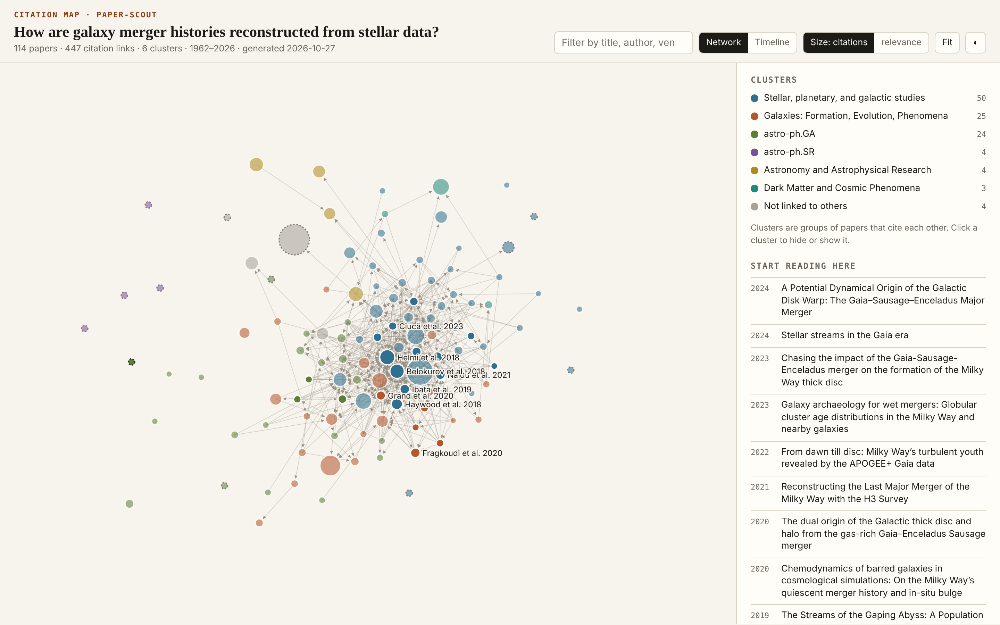
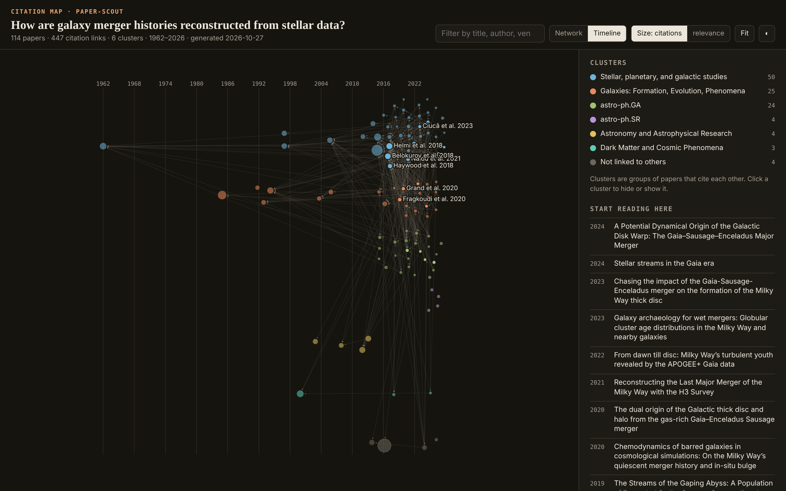
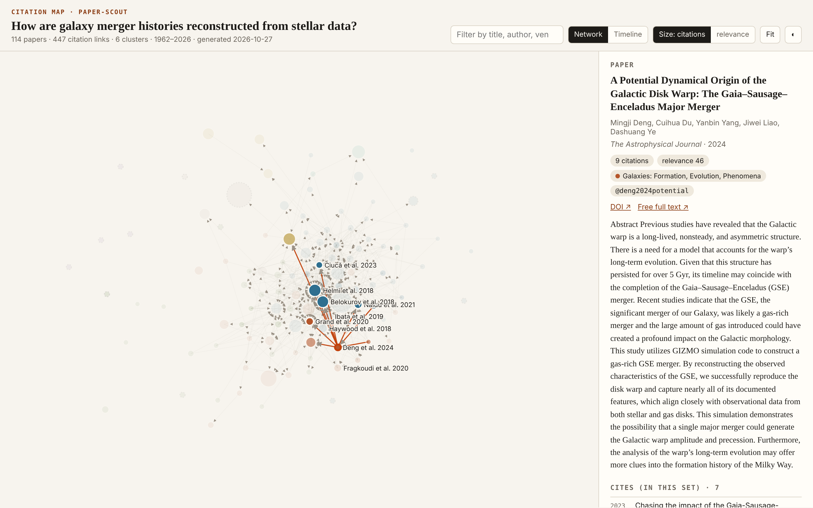
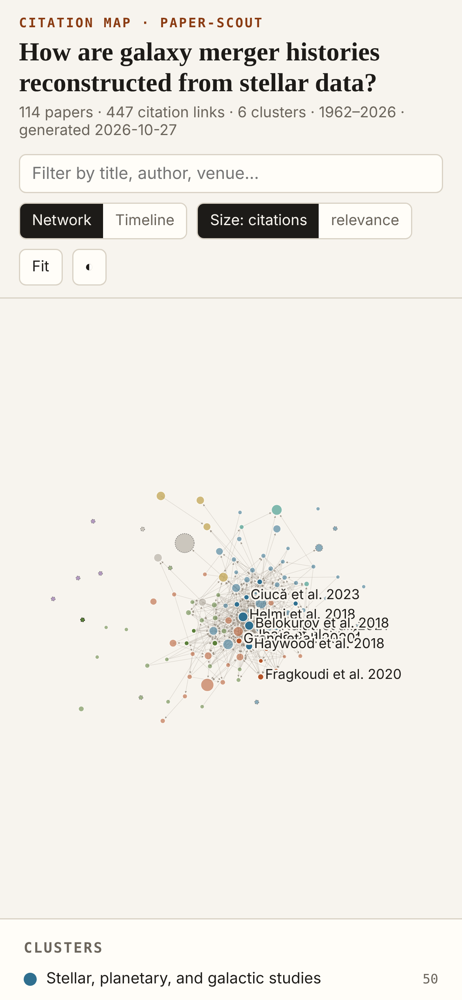

# Paper Scout

Find real, citable research papers for any question — ranked, de-duplicated, mapped and ready to cite.

A free, open-source [agent skill](https://www.agensi.io/learn/skill-md-format) (SKILL.md) for students and researchers. Works with Claude Code, Codex CLI, Cursor, Gemini CLI and any agent that supports the SKILL.md standard.

## Screenshots

| Network view: research clusters and who cites whom | Timeline view (dark): how the ideas developed |
|---|---|
|  |  |
| **Paper panel:** abstract, links, in-set citations | **Mobile** |
|  |  |

*Real output, not a mock-up:* a run on the question **“How are galaxy merger histories reconstructed from stellar data?”** (OpenAlex + arXiv, 114 papers). The files are in [`examples/milky-way-mergers/`](examples/milky-way-mergers/) — download `citation_map.html` and open it in a browser.

## What it does

- Searches **OpenAlex**, **Semantic Scholar** and **arXiv** (free APIs, no keys required) with several search strings.
- **Snowballs** through references and citing papers of the best hits.
- **De-duplicates** across sources by DOI, arXiv id and title; keeps the richest metadata; flags **preprints**.
- **Ranks** by relevance to the question, citation rate and recency; the agent then screens titles and abstracts like a researcher.
- Writes **`references.bib`** and **`citation_map.html`** — an interactive, offline map with a network view (research clusters) and a timeline view (how ideas developed).

**No hallucinated papers.** Every paper comes from an API record with a DOI, arXiv id or URL. If the APIs can't be reached, the skill says so instead of guessing.

## Use the script directly

```bash
S=scripts/scout.py; OUT=research/gnn-drugs
python3 $S search   --out $OUT --query "Do GNNs improve molecular property prediction?" \
                    --terms "graph neural network molecular property" "message passing drug discovery" --year-from 2017
python3 $S rank     --out $OUT --keep 40
python3 $S snowball --out $OUT --top 5
python3 $S enrich   --out $OUT
python3 $S rank     --out $OUT --keep 25
python3 $S bib      --out $OUT
python3 $S map      --out $OUT
```

Optional: `OPENALEX_MAILTO=you@example.com` (faster OpenAlex pool), `S2_API_KEY` (higher Semantic Scholar limits).

## Network

Contacts only `api.openalex.org`, `api.semanticscholar.org` and `export.arxiv.org`. Writes only inside the `--out` folder. The generated map makes no network requests.

## Part of the Research Suite

Three free, open-source agent skills that chain through one shared data format ([`references/schema.md`](references/schema.md)):

| Step | Skill | What it does |
|---|---|---|
| 1 |  [paper-scout](https://github.com/AppleBoiy/paper-scout) | Finds real papers, ranks them, draws a citation map, writes BibTeX |
| 2 |  [claim-conflict-finder](https://github.com/AppleBoiy/claim-conflict-finder) | Extracts findings as claims and shows where and why papers disagree |
| 3 |  [research-dossier](https://github.com/AppleBoiy/research-dossier) | Writes a visual, citation-checked literature review |

Each skill also works on its own.

## Install

**Any agent through Agensi** — search for `paper-scout` on [agensi.io](https://www.agensi.io) and add it (free).

**Claude Code**

```bash
git clone https://github.com/AppleBoiy/paper-scout.git ~/.claude/skills/paper-scout
```

**Other SKILL.md agents** (Codex CLI, Cursor, Gemini CLI, …) — clone the repo into the agent's skills folder. The agent reads `SKILL.md`; the scripts need Python 3.10+ and nothing else.

Then just ask, e.g. *"Find the key papers on graph neural networks for drug discovery from the last 8 years."*

## Development

```bash
python3 -m unittest discover -s tests -v   # offline tests, no network needed
python3 tools/package.py                    # builds dist/paper-scout.zip for Agensi (templates embedded into the script)
```

`assets/` holds the HTML template(s); `scripts/` loads them from there during development, and the packaged zip embeds them so the script runs as a single file.

## License

MIT © [Chaipat Jainan](https://www.chaipat.cc). Issues and pull requests welcome.
